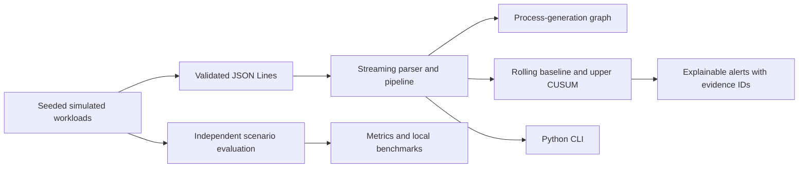

# KERNEL SENTINEL

**Python-only process-behavior anomaly research MVP.** This project generates deterministic synthetic process telemetry, validates and correlates it, and tests an explainable rolling-statistics/CUSUM detector. It does not observe the host kernel, and it does not determine intent.

## Problem statement

Security researchers need a reproducible way to test process-behavior analytics before wiring in an operating-system sensor. Kernel Sentinel supplies a local simulator, a strict JSON Lines contract, a bounded streaming pipeline, an in-memory process-generation graph, change detection, an evaluation harness, and measured local benchmarks. Synthetic labels are for evaluation only and are not detection inputs.

## Architecture



```mermaid
sequenceDiagram
    participant S as Simulator
    participant V as JSONL validator
    participant G as Process graph
    participant D as Count detector
    participant A as Alert
    S->>V: simulated event / loss report
    V->>G: validated event with process ID
    G->>D: bucket count + evidence IDs
    D->>A: threshold crossing and prior baseline
    Note over V,D: Loss report skips the bucket; labels never enter detection
```

The generated [architecture SVG](docs/diagrams/architecture.svg) and [process identity SVG](docs/diagrams/process-identity.svg) are made by the standard-library script `python scripts\generate_diagrams.py`.

## Repository tree

```text
.
|-- README.md
|-- pyproject.toml                 # optional package installation / console entry point
|-- requirements.txt               # no third-party runtime requirements
|-- schemas\telemetry.schema.json
|-- src\kernel_sentinel\
|   |-- cli.py
|   |-- pipeline.py
|   |-- investigation.py
|   |-- detection\cusum.py
|   |-- evaluation\metrics.py
|   |-- graph\process_graph.py
|   |-- simulator\generator.py
|   \-- telemetry\schema.py
|-- tests\
|-- scripts\generate_diagrams.py
|-- docs\                         # architecture, math, test and audit notes
|-- reports\                      # captured evaluation and benchmark outputs
|-- fixtures\                     # reserved for hand-authored fixtures
\-- LICENSE
```

## Windows setup

Python 3.11 or newer is required. The checked development environment is Windows 11 with Python 3.14.3. No admin access, WSL, Docker, GPU, model, API key, or third-party runtime package is required.

```powershell
cd "E:\FX\C.D\KERNEL SENTINEL"
py -3 -m venv .venv
.\.venv\Scripts\Activate.ps1
$env:PYTHONPATH = "$PWD\src"
```

If PowerShell blocks activation, skip activation and invoke `.\.venv\Scripts\python.exe` instead. Runtime dependencies are standard-library only; editable installation is optional (`python -m pip install -e .`) and is not required by the commands below.

## Exact run commands

Generate 120 mixed scenario minutes, deterministically:

```powershell
New-Item -ItemType Directory -Force .\reports | Out-Null
python -m kernel_sentinel simulate --seed 42 --buckets 120 --scenario mixed --output .\reports\sample.jsonl
```

Analyze the generated records:

```powershell
python -m kernel_sentinel detect .\reports\sample.jsonl
```

The `detect` command emits one JSON object per alert and a final JSON summary. It returns exit code 2 if malformed records, loss, ordering/graph integrity problems, or a capacity failure made the run incomplete; a capacity failure stops processing. To stream the simulator directly to a detector, keeping simulator status on stderr:

```powershell
python -m kernel_sentinel simulate --seed 42 --buckets 120 | python -m kernel_sentinel detect
```

Run independent deterministic evaluation and the local benchmark:

```powershell
python -m kernel_sentinel evaluate --seed 4242 --buckets 180 --output .\reports\evaluation.json
python -m kernel_sentinel benchmark --seed 2025 --buckets 1000 --output .\reports\performance.json
```

Run the complete test suite with one PowerShell-friendly command:

```powershell
$env:PYTHONPATH = "$PWD\src"; python -m unittest discover -s tests -v
```

To inject loss and malformed JSON on purpose:

```powershell
python -m kernel_sentinel simulate --seed 9 --buckets 120 --loss-rate 0.02 --malformed-rate 0.01 --output .\reports\faults.jsonl
python -m kernel_sentinel detect .\reports\faults.jsonl
```

## Example alert

Values depend on the supplied seed and options; this illustrates the output shape, not a claimed run result:

```json
{"alert_id":"alert-000001","timestamp":"2025-01-01T01:01:00Z","feature":"file_access","observed_count":14,"baseline_mean":2.3,"baseline_variance":1.1,"cusum_statistic":8.7,"evidence_event_ids":["sim-00000123"],"explanation":"file_access count 14 exceeded its rolling baseline (mean=2.300, variance=1.100); CUSUM threshold crossed. Statistical deviation is not proof of malicious intent."}
{"record_type":"summary","incomplete":false,"termination_reason":null,"processed_events":100,"alerts":1,"malformed_records":0,"dropped_events":0,"missing_buckets":0,"graph_integrity_issues":0,"errors":[],"error_count":0}
```

## Statistical assumptions

Each finalized one-minute bucket contributes a non-negative count per observed event type. The rolling baseline uses a bounded window, population mean, and population variance. For approximately independent, equally sized count intervals, a Poisson model motivates variance near the mean; the implementation instead uses the greater of empirical variance, empirical mean, and one to avoid zero-variance division. The one-sided CUSUM accumulates standardized positive deviations with configurable allowance and threshold. It does not model seasonality, autocorrelation, exposure changes, or causal relationships. See [the mathematical model](docs/MATHEMATICAL_MODEL.md).

## Verification and performance

The final run executed **31 `unittest` tests: all passed** on Windows 11 / Python 3.14.3. In the seed-2025, 1,000-bucket local benchmark, the pipeline processed 9,117 records at 6,926 records/second (0.1444 ms mean per record); incremental `tracemalloc` peak was 5,113,699 bytes. This was one run, excludes the pre-materialized input from traced memory, and is not RSS or a performance guarantee. The synthetic burst and suspicious evaluation scenarios had low event-level recall (about 2.8% and 3.7%, respectively), so this implementation is an engineering MVP, not an effective threat detector. Machine details and captured measurements are recorded in [the environment report](docs/ENVIRONMENT_REPORT.md), [testing notes](docs/TESTING.md), and [reports](reports/).

## Security and limitations

The input is untrusted JSONL: records are validated, duplicate object keys and unknown fields are rejected, and retained event/diagnostic state is bounded. The optional investigation interface accepts structured evidence and returns text only; it has no command execution capability. Synthetic anomalies are not proof of malicious behavior. This MVP is not a host-monitoring, incident-response, or production security product. Review [the threat model](docs/THREAT_MODEL.md), [security policy](SECURITY.md), and [limitations](docs/LIMITATIONS.md).

## Future Linux/eBPF integration

There is no native sensor or simulated claim of live telemetry in this repository. A future, separately implemented Linux sensor must satisfy the documented event, identity, time, and loss contract in [the architecture](docs/ARCHITECTURE.md), then be validated on compatible Linux hosts. Native eBPF remains **unimplemented and unverified**.

## Further documentation

- [Project overview](docs/PROJECT_OVERVIEW.md) · [Architecture and telemetry interface](docs/ARCHITECTURE.md) · [Mathematical model](docs/MATHEMATICAL_MODEL.md)
- [Threat model](docs/THREAT_MODEL.md) · [Build and run](docs/BUILD_AND_RUN.md) · [Testing](docs/TESTING.md) · [Performance](docs/PERFORMANCE.md)
- [Limitations](docs/LIMITATIONS.md) · [Roadmap](docs/ROADMAP.md) · [Environment report](docs/ENVIRONMENT_REPORT.md) · [Independent audit](docs/INDEPENDENT_AUDIT.md)
- [Contributing](CONTRIBUTING.md) · [Changelog](CHANGELOG.md) · [License](LICENSE)
